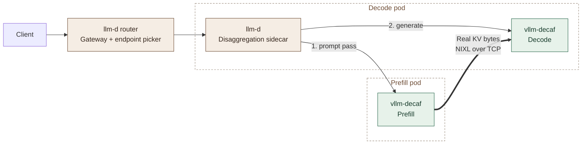

# vllm-decaf as llm-d's prefill and decode servers

The two model-server Deployments of a prefill/decode setup behind
[llm-d](https://llm-d.ai) v1.0, with vllm-decaf in place of GPU servers: real
vLLM with simulated compute. No GPU is requested.



| Path | Contents |
| :--- | :--- |
| `serving/prefill.yaml` | Prefill pods: vllm-decaf as the KV producer. |
| `serving/decode.yaml` | Decode pods: llm-d's disaggregation sidecar (unmodified) in front of vllm-decaf as the KV consumer. |
| `l1/` | The same pods with the [KV transfer profiler](../../docs/observability/kv_profiler_core.md) at L1: see [Profiling](#profiling). |
| `profiling/` | L1 plus the profiler's endpoint observer (L3) as a pod sidecar: see [Profiling](#profiling). |
| `router/` | An optional in-cluster llm-d router (endpoint picker and Envoy) for clusters without llm-d's gateway: see [Without llm-d's gateway](#without-llm-ds-gateway). |

What is real: vLLM's scheduling, metrics and KV cache on both sides, the
sidecar's two-step request, and the KV bytes that cross the pod network.
What is simulated: the forward pass, timed by AISimulate as an H100 would
run the published model.

## Before you apply

1. **The image.** Build `vllm:cpu-aisim` (see the repository README) and make
   it available to the cluster: push it to a registry the nodes can pull from
   and set `image` in both files, or load it into the nodes' container
   runtime.
2. **Internet access from the pods**, or a Hugging Face mirror: each server
   downloads its model's configuration and tokenizer at startup (a few MB,
   never the weights).

## Deploy

```bash
kubectl apply -n <namespace> -k deploy/llm-d/serving
kubectl -n <namespace> rollout status deploy/vllm-decaf-prefill deploy/vllm-decaf-decode
```

Send a request through the router's gateway with model
`Qwen/Qwen3-8B`. The reply has real usage counts and timing; its text is
filler. To see that the request was disaggregated, look at where decode's
prompt tokens came from:

```bash
kubectl -n <namespace> exec deploy/vllm-decaf-decode -c vllm-decode -- \
  curl -s localhost:8200/metrics | grep prompt_tokens_by_source_total
```

`source="external_kv_transfer"` counts the prompt tokens whose KV cache
decode pulled from a prefill pod instead of computing.

## Make it yours

- **Model and GPU.** Change the model name in both files and `gpu` in
  `--simulation-config` (`a100`, `h100`, `h200`, `b200`). The model must be
  one AISimulate times; see the supported list in the repository README. For
  a quick test without AISimulate, use the `vllm:cpu` image and
  `"timing": "linear"` with `timing_args`.
- **Sizes.** `--kv-cache-memory-bytes` is real host memory per pod: it holds
  the KV buffers. Set it, and the pods' memory, to what your nodes allow.
- **Replicas.** Scale the two Deployments independently.
- **A dedicated KV network.** These manifests move KV over the pod network.
  With a secondary network (Multus, say), point `VLLM_NIXL_SIDE_CHANNEL_HOST`,
  `NIXL_MOONCAKE_IP_ADDR` and the addresses in `MC_TENT_CONF` at the pod's
  address on it.
- **The KV connector.** See below.

## Changing the KV connector

As written, KV moves through vLLM's `NixlConnector` on NIXL's Mooncake
backend (Mooncake's transfer engine over TCP). The other TCP paths are a
few edits to **both** `serving/prefill.yaml` and `serving/decode.yaml` (with the
profiler, to the server arguments in `l1/prefill.yaml` and `l1/decode.yaml`,
which repeat them, and its `KV_TRANSFER_CONFIG` in `l1/` and `profiling/`):

| KV path | `--kv-transfer-config` | Environment | Sidecar |
| :--- | :--- | :--- | :--- |
| **NIXL over Mooncake** (as written) | `"kv_connector": "NixlConnector"`, `"backends": ["Mooncake"]` | as written | `--kv-connector=nixlv2` |
| **NIXL over UCX** | `"backends": ["UCX"], "rank_addresses": ["$(POD_IP)"]` | remove `MC_USE_TENT`, `MC_TENT_CONF`, `NIXL_MOONCAKE_IP_ADDR`; add `UCX_TLS=tcp,self` | unchanged |
| **NIXL over libfabric** | `"backends": ["LIBFABRIC"], "rank_addresses": ["$(POD_IP)"]` | remove the same three; add `FI_PROVIDER=tcp`, `FI_ADDR_FORMAT=FI_SOCKADDR_IN`, `FI_PREFER_SYSCONFIG=0` | unchanged |
| **vLLM's `MooncakeConnector`** | `"kv_connector": "MooncakeConnector"`, `"kv_connector_extra_config": {"mooncake_protocol": "tcp"}` | remove `VLLM_NIXL_SIDE_CHANNEL_HOST`, `NIXL_MOONCAKE_IP_ADDR`; add `VLLM_MOONCAKE_BOOTSTRAP_PORT=8998` | `--kv-connector=mooncake --mooncake-bootstrap-port=8998` |

`kv_role` and `kv_buffer_device` stay as they are. Kubernetes expands
`$(POD_IP)` inside `args` as it does inside `env`, so `rank_addresses` can
name the pod's address directly; UCX and libfabric bind to the interface
that holds it.

## Profiling

Two overlays add the [KV transfer profiler](../../docs/observability/kv_profiler_core.md)
to the same pods, in place of `serving`:

| Overlay | What it records |
| :--- | :--- |
| `l1` | L1: vLLM's own recorders (requests, transfers, peer clocks), no observer. |
| `profiling` | L3: `l1`, plus an endpoint observer beside each server (its interface, the serving threads' CPU, interrupts). |

```bash
kubectl apply -n <namespace> -k deploy/llm-d/profiling   # or deploy/llm-d/l1
```

**One run per P/D pair.** The prefill and decode pods record one run, so their
recordings join: the `kvp-run` ConfigMap's `run_id`. Set a new UUID in the
overlay's `kustomization.yaml` (in `l1`, which `profiling` builds on) for each
run and apply it again. The ConfigMap's name is a hash of its content, so both
pod templates change and both Deployments roll out on the new run before the
next workload. Wait for both rollouts before sending it.

**Closing on termination.** At vLLM's default `--shutdown-timeout 0` the
engine-core process, which holds the scheduler and worker recorders, is
force-killed on SIGTERM before they close. The `l1` overlay gives it a cleanup
grace (`VLLM_WORKER_SHUTDOWN_TIMEOUT_SECONDS`, under the pod's
`terminationGracePeriodSeconds`), and its container exits only once vLLM's whole
process group, the recorders' writers included, has exited.

**Where it goes.** Each pod keeps its files on its node after the pod is gone,
under `/var/lib/vllm-decaf/kvp/<pod UID>/`:
- `profiles/gen-<start>/<run ID>/` holds the L1 recordings. Each start of the
  vLLM container (a restart included) records into a generation of its own, so
  recordings never mix.
- `observer/attempt-*/` holds the observer's captures (`profiling`), one per
  start of its sidecar.

Any volume that outlives the pod can replace the `hostPath`, for example a
PersistentVolumeClaim per replica.

**The observer** (`profiling`) is a native sidecar (`kv-observer`): an init
container with `restartPolicy: Always`, in the pod's network namespace and, with
`shareProcessNamespace: true`, its PID namespace.
- **Start:** it starts before vLLM without holding it back, finds the vLLM
  start whose frontend, scheduler and worker recorders are running, and starts
  the observer.
- **Readiness:** the pod is Ready, and routed to, only while the observer is.
  If the observer fails or stalls, the sidecar exits nonzero and Kubernetes
  restarts it.
- **Termination:** within `stop_grace_s` (and the pod's
  `terminationGracePeriodSeconds`), the sidecar withdraws readiness at once.
  It waits for vLLM's processes to exit, the serving parent included, and
  their recordings to close. A process whose status it cannot read is never
  taken as exited. It then stops the observer, within the same deadline, and
  records its exit.

Check an attempt with the same image's observer, by path, so it imports neither
vLLM nor Torch (the attempt's `config.json` names its generation):

```bash
python /opt/venv/lib/python3.12/site-packages/vllm/kv_profiling/probe.py \
  --check-capture <attempt> --core-dir <its generation>
```

Requirements of the observer:

- **CPUs of its own.** The observer refuses to share CPUs with the server it
  measures, so the pods need exclusive CPUs: the kubelet's `static` CPU manager
  policy, and Guaranteed pods with whole CPUs. The overlay sets requests equal
  to limits, integer CPUs, in every container. Without them the observer does
  not start, and the pod never becomes Ready.
- **Interrupts.** The overlay measures the pod's `eth0`, a virtual interface
  (`irq_policy: virtual_not_applicable`). For a physical interface (a dedicated
  KV network), verify its interrupt placement and set `operator_verified`.
- **TCP sockets** are not sampled by default: the TCP source needs the
  endpoints' addresses, which a pod network assigns at runtime. With fixed
  addresses (a dedicated KV network), add `tcp` with `local_ips` and `peer_ips`
  to the observer's probes.

### eBPF events (opt-in)

The observer can also record TCP retransmits, resets and state changes with its
eBPF collector. It is off in the overlay; turning it on takes three changes, on
nodes whose kernel has BTF (Linux 5.15 or newer):

1. **The built package.** Build the artifacts with `tools/kv-profiler-ebpf/build.sh`
   (in its tooling image), then make them available on each node, for example at
   `/opt/kv-profiler-ebpf`.
2. **Privileges and the mount** in the `kv-observer` container:
   ```yaml
   securityContext:
     allowPrivilegeEscalation: false
     capabilities:
       add: [BPF, PERFMON]
   volumeMounts:
   - name: kv-profiler-ebpf
     mountPath: /opt/kv-profiler-ebpf
     readOnly: true
   ```
   with a `hostPath` volume `kv-profiler-ebpf` of that directory. Nothing broader
   is needed, never `CAP_SYS_ADMIN`.
3. **The probe settings** in `observer-<side>.json`. Add `"ebpf"` to `required`,
   and:
   ```json
   "ebpf": {"enabled": true, "privileged_opt_in": true,
            "mode": "tcp_tracepoints", "artifacts": "/opt/kv-profiler-ebpf"}
   ```
   In a pod the collector sees only the pod's own network namespace. For a
   shared one, `local_ips` and `peer_ips` keep it to the KV link.

## Without llm-d's gateway

`deploy/llm-d/router` is an in-cluster llm-d router for a cluster that has no
Gateway implementation serving InferencePools. llm-d's endpoint picker and Envoy
run in one pod, with the configuration of llm-d v1.0's P/D guide, and the picker
finds the pods through an InferencePool. It needs the InferencePool CRD of the
release the picker is built against:

```bash
kubectl apply -f https://github.com/kubernetes-sigs/gateway-api-inference-extension/releases/download/v1.6.2/manifests.yaml
kubectl apply -n <namespace> -k deploy/llm-d/router
```

Send requests to the `llm-d-router` Service on port 80. With llm-d's gateway
installed, point it at the `vllm-decaf` InferencePool instead.
